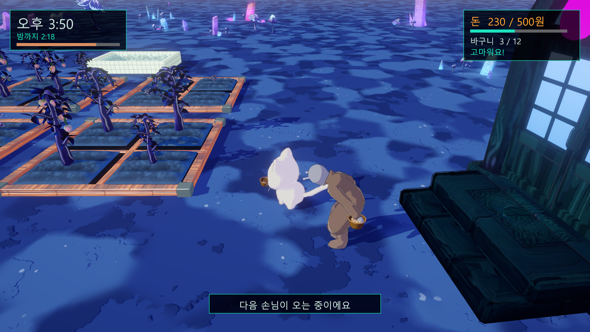

# 밤이 오기 전 수확 (Harvest Before Night)

외계 행성 농장에서 바구니를 문 고양이가 손님의 주문을 채우는 Unity 3D 1스테이지 프로토타입입니다.
제2차 성취도 평가 · Unity 게임 프로토타입 개발 (김기인, 2026-10-22)

## 게임

- 오후 2시에 시작해 밤 10시가 되면 끝납니다 (실제 3분). 시간이 흐르면 하늘과 조명이 함께 저뭅니다.
- 밭에서 등불 열매와 버섯꽃을 수확해 바구니에 담고(12개까지), 가게 문 앞 손님의 주문을 채웁니다.
- 열매 1개에 10원, 주문을 다 채우면 보너스 20원. 돈을 낸 손님은 들어가고 옷 색이 다른 손님이 나옵니다.
- **밤 10시 전에 500원**을 벌면 성공, 그 전에 밤이 오면 실패입니다. 수확한 작물은 잠시 뒤 다시 자랍니다.

## 조작

| 입력 | 동작 |
|---|---|
| W A S D | 이동 (카메라 기준) |
| Shift | 달리기 |
| E / Space | 수확 · 납품 |
| 마우스 오른쪽 드래그 · 휠 | 카메라 회전 · 줌 |
| Enter · Esc · R | 시작 · 일시 정지 · 다시 하기 |

## 실행

- 빌드: `HarvestBeforeNight.exe` (Windows 64bit) — 제출 폴더의 빌드 압축을 풀어 실행
- 프로젝트: Unity 6000.3.24f1 (URP)로 이 폴더를 열고 `Assets/Scenes/Stage1.unity`
- `-demo` 옵션으로 실행하면 고양이가 스스로 플레이합니다 (플레이 영상 촬영용)

## 구성

| 경로 | 내용 |
|---|---|
| `Assets/Scripts/Gameplay/` | GameDirector(시간 · 승패) · GameHUD(UI) · CatController(이동 · 애니 속도) · CatHarvester(수확 · 납품) · DeliveryPoint(손님 · 주문 · 돈) · RipeCrop(작물 · 다시 자람) · BasketFill · FollowCamera · DemoAutopilot |
| `Assets/Art/` | 1차 제출 에셋(외계인 손님 · 등불 열매 · 가게 문), 1차 이전 개인 프로젝트에서 직접 만든 배경 · SD 고양이, 팀 프로젝트 밭 · 버섯꽃, Varco(AI) 바구니 |
| `Docs/DevLog.md` | AI 코딩 도구(Claude Code)에 한 요청, 수정 내용, 오류와 해결 기록 |
| `Docs/Media/` | 개발 과정 이미지 |
| `Docs/Portfolio/` | 포트폴리오 PDF와 원본 HTML |

플레이 영상(1분 22초)과 빌드 압축은 용량 때문에 저장소에 넣지 않고 제출 폴더로 따로 제출합니다.
